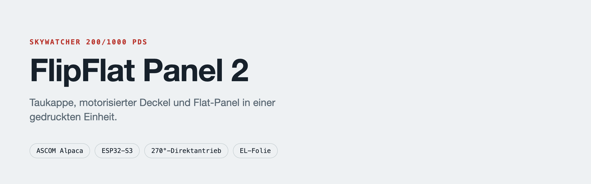
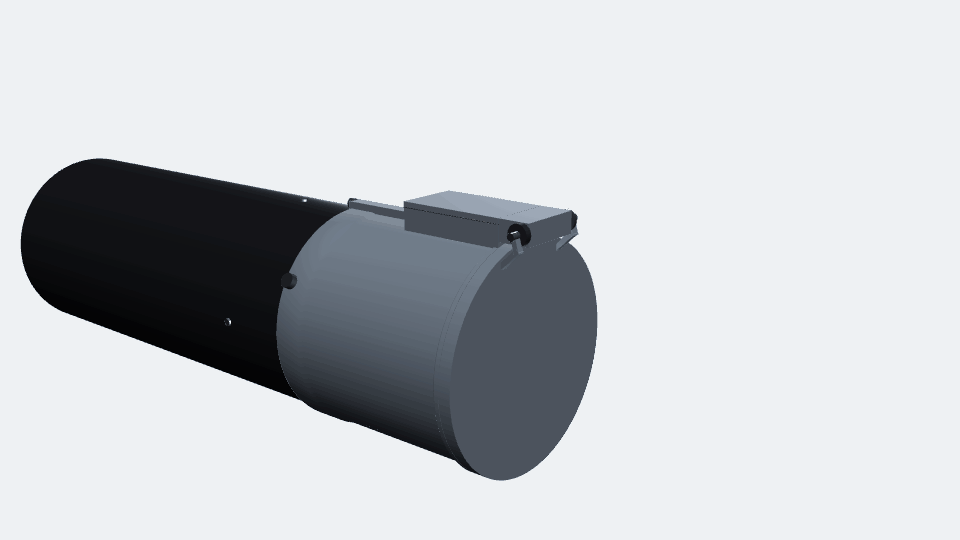
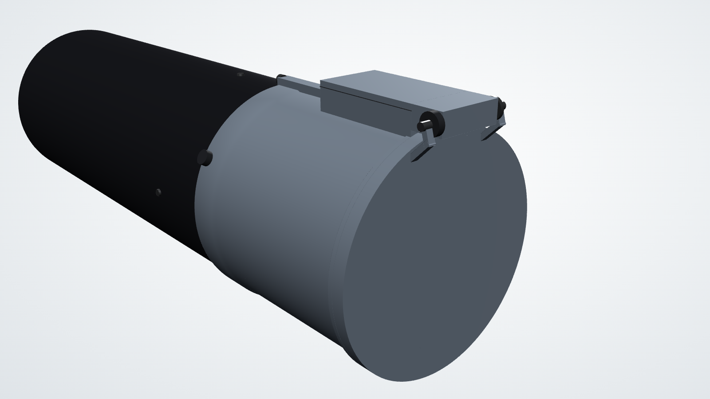
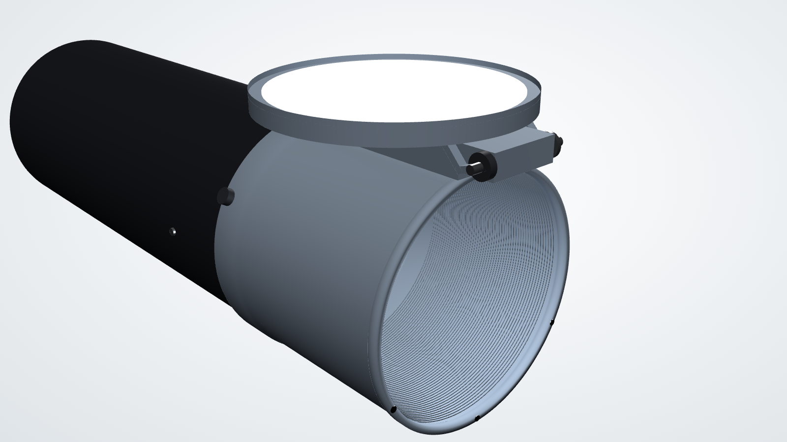
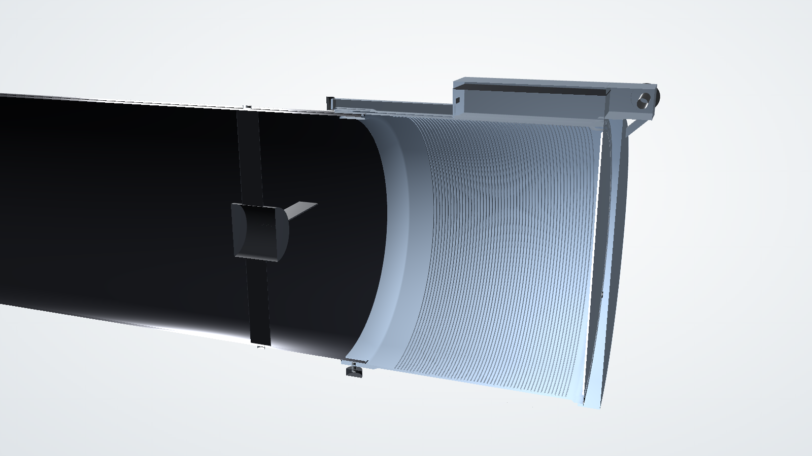
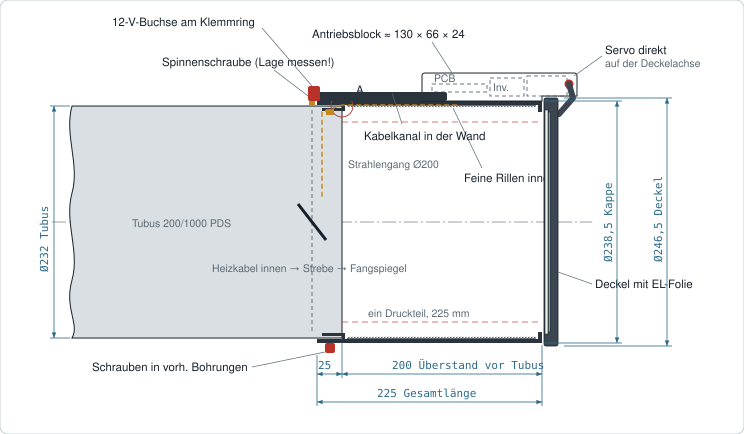

<p align="center">
  <picture>
    <source media="(prefers-color-scheme: dark)" srcset="docs/images/banner-dark.de.png">
    
  </picture>
</p>

<p align="center">
  <a href="README.md">English</a> · <b>Deutsch</b>
</p>

<p align="center">
  
  
  
  
  
</p>

**FlipFlat Panel 2** macht aus der Front eines Newton-Teleskops eine aufgeräumte, gedruckte Einheit. Sie besteht aus einer **Taukappe**, einem **motorisierten Deckel**, der um 270° aufklappt und flach parkt, und einer **EL-Folie als Flat-Panel** im Deckel. Gesteuert wird sie über WLAN als **ASCOM Alpaca CoverCalibrator**. So kann N.I.N.A. oder eine andere Aufnahmesoftware den Deckel schließen, Flats aufnehmen und wieder öffnen, ohne dass jemand ans Teleskop muss.

Das erste Zielgerät ist der **Skywatcher 200/1000 PDS**. Alle Maße leiten sich aus wenigen gemessenen Werten ab, andere Tuben können also folgen.

<p align="center">
  
</p>

> [!NOTE]
> Das Projekt ist in der **Entwurfsphase** (Rev J). Zeichnungen und 3D-Modell zeigen das Konzept. CAD-Dateien, Platine und Bauanleitung folgen, sobald der Tubus vermessen ist. Siehe [Fahrplan](#fahrplan).

## Das Wichtigste

- **Ein Block, ein Kabel.** Servo, Steuerung, EL-Inverter und Sensoren sitzen in einem flachen Antriebsblock oben auf der Kappe. 12 V ist das einzige Kabel von außen. Es läuft in einem Kanal, der in die Kappenwand eingeformt ist.
- **Randklemmung statt Kabelbinder.** Ein U-Profil wird auf den Tubusrand gesteckt und von einer Innenlippe zentriert. Geschraubt wird in die Bohrungen des originalen Frontrings, es wird also nichts gebohrt.
- **270°-Direktantrieb.** Die Servowelle ist die Deckelachse. Es gibt kein Gestänge und kein Spiel, und der Deckel parkt flach außerhalb des Strahlengangs.
- **Lichtdicht ohne Kraft.** Eine Lippe am Deckel übergreift die Kappenkante und bildet ein Lichtlabyrinth. Drei kleine Magnete ziehen den Deckel nur plan.
- **Echter Deckelstatus.** Hall-Sensoren nutzen die vorhandenen Park- und Armmagnete. Der Treiber meldet so den gemessenen `CoverState` statt eines angenommenen.
- **Taubeschlag geregelt.** Ein BME280 bestimmt den Taupunkt, ein Heizkanal wärmt den Fangspiegel. Beim Newton beschlägt der Fangspiegel zuerst.
- **In einem Stück druckbar.** Die 225 mm lange Kappe passt stehend auf einen Drucker mit 256 mm Bauhöhe. Feine Sägezahn-Rillen innen schlucken Streulicht und brauchen keine Stützen.

## So funktioniert es

<p align="center">
  
  
</p>
<p align="center">
  
</p>

| Blatt | Inhalt |
|---|---|
| [Seitenansicht](docs/images/drawing-side-view.de.svg) | Hauptmaße, Kabelkanal, Strahlengang, Antriebsblock |
| [Detail A – Randklemmung](docs/images/drawing-detail-a-rim-clamp.de.svg) | U-Profil, Innenlippe, Schraube in Gewindeeinsatz |
| [Detail B – Magnete](docs/images/drawing-detail-b-magnets.de.svg) | Lippenlabyrinth, eingedruckter Magnet, Stahlscheibe |
| [Antriebsblock](docs/images/drawing-drive-block.de.svg) | Platine, Inverter, Servo, Hall-Sensoren, Lager |
| [Deckel, Explosion](docs/images/drawing-lid-exploded.de.svg) | Druckrahmen, Trägerplatte mit EL-Folie, optional Diffusor |
| [Frontansicht](docs/images/drawing-front-view.de.svg) | Spinne, Schrauben, Antriebsblock bei 12 Uhr |

<p align="center">
  
</p>

Das interaktive Entwurfsblatt mit 3D-Modell, Schnittansicht und Bewegungsstudie liegt in [`docs/design-sheet.html`](docs/design-sheet.html). Herunterladen und im Browser öffnen.

## Eckdaten

| | |
|---|---|
| Teleskop | Skywatcher 200/1000 PDS (Tubus Ø ≈ 232 mm, wird gemessen) |
| Kappe | 225 mm lang, Ø ≈ 238,5 mm, Wand 2 mm, PETG oder ASA, ein Druckteil |
| Deckel | Ø ≈ 246,5 mm, Druckrahmen + vorhandene Trägerplatte mit EL-Folie |
| Antrieb | Servo DS3218MG, **270°-Version**, ≈ 20 kg·cm, 6 V |
| Antriebsblock | ≈ 130 × 66 × 24 mm bei 12 Uhr |
| Steuerung | ESP32-S3-MINI-1, ASCOM Alpaca über WLAN, USB-C für Service |
| Sensoren | BME280 (Taupunkt), 2 × Hall-Endlage |
| Ausgänge | EL-Inverter (PWM-Dimmung), Fangspiegelheizung |
| Versorgung | 12 V DC, ein Kabel |

Alle Durchmesser ergeben sich aus zwei Messwerten. Siehe [Design → Parameter](docs/de/design.md#parameter).

## Dokumentation

| | Deutsch | English |
|---|---|---|
| Design und Entscheidungen | [docs/de/design.md](docs/de/design.md) | [docs/en/design.md](docs/en/design.md) |
| Teleskop vermessen | [docs/de/messen.md](docs/de/messen.md) | [docs/en/measuring.md](docs/en/measuring.md) |
| Bauanleitung (Entwurf) | [docs/de/bauanleitung.md](docs/de/bauanleitung.md) | [docs/en/build-guide.md](docs/en/build-guide.md) |
| Stückliste | [hardware/BOM.md](hardware/BOM.md) | [hardware/BOM.md](hardware/BOM.md) |
| Firmware | [firmware/README.md](firmware/README.md) | [firmware/README.md](firmware/README.md) |

> Die Firmware in `firmware/` ist die lauffähige v1.1 für ein ESP32-WROOM-32-Devboard (Alpaca, BME280, Heizung, Hall, SoftClose). Sie wird auf die ESP32-S3-Platine des Antriebsblocks portiert.

## Aufbau des Repos

```text
FlipFlat-Panel-2/
├── docs/
│   ├── en/  de/            Design, Messanleitung, Bauanleitung
│   ├── images/             Renderings, Zeichnungen (SVG, DE + EN), Animation
│   └── design-sheet.html   interaktives Entwurfsblatt mit 3D-Modell
├── hardware/
│   ├── BOM.md              Stückliste
│   ├── cad/                parametrisches CAD-Modell (geplant)
│   └── pcb/                Platine für den Antriebsblock (geplant)
└── firmware/               ESP32-Alpaca-Firmware (mit Historie übernommen)
```

## Fahrplan

- [x] Konzept, Randklemmung, Antrieb und Dichtung (Rev A–J)
- [x] Zeichnungen, 3D-Modell und Bewegungsstudie
- [ ] Tubus vermessen und Parameter eintragen ([Anleitung](docs/de/messen.md))
- [ ] Parametrisches CAD-Modell (OpenSCAD) und STL-Export
- [ ] Testdrucke: Abschnitt des Klemmrings und Magnet-Testring
- [ ] Platine für den Antriebsblock (ESP32-S3, 6-V-Wandler, 2 × MOSFET, Hall, BME280)
- [ ] Firmware auf die neue Platine portieren, danach Alpaca-Test mit ConformU
- [ ] Bauanleitung mit Fotos

## Credits

Das ursprüngliche FlipFlat-Konzept, die Schaltung und das Hardware-Design stammen von **Moritz Mayer** aus dem [Dark Matters Discord](https://discord.gg/darkmatters). Dieses Projekt baut darauf auf. Die Randklemmung ist von den Strato-Taukappen von 3D-Druck Krug inspiriert. Die Geometrie hier ist eine eigene.

## Lizenz

[MIT](LICENSE) © 2026 Kai Linde. Das gilt für die Hardware-Entwürfe, die Dokumentation und die Firmware.
