<p align="center">
  <picture>
    <source media="(prefers-color-scheme: dark)" srcset="docs/images/banner-dark.en.png">
    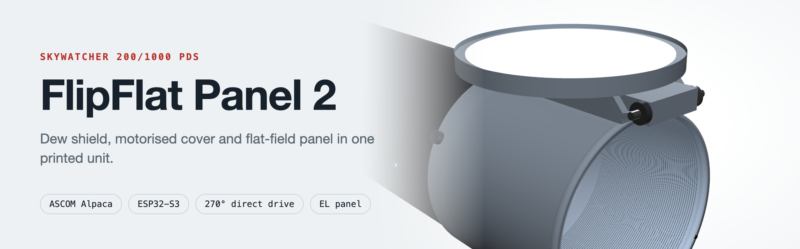
  </picture>
</p>

<p align="center">
  <b>English</b> · <a href="README.de.md">Deutsch</a>
</p>

<p align="center">
  
  
  
  
  
</p>

**FlipFlat Panel 2** turns the front of a Newtonian telescope into one tidy, printed unit: a **dew shield**, a **motorised cover** that flips open by 270° and parks flat, and an **electroluminescent flat-field panel** inside the cover. It is controlled over Wi-Fi as an **ASCOM Alpaca CoverCalibrator**, so N.I.N.A. and other imaging software can close the cover, take flats and open it again without anyone touching the telescope.

The first target is the **Skywatcher 200/1000 PDS**. All dimensions derive from a few measured values, so other tubes can follow.

<p align="center">
  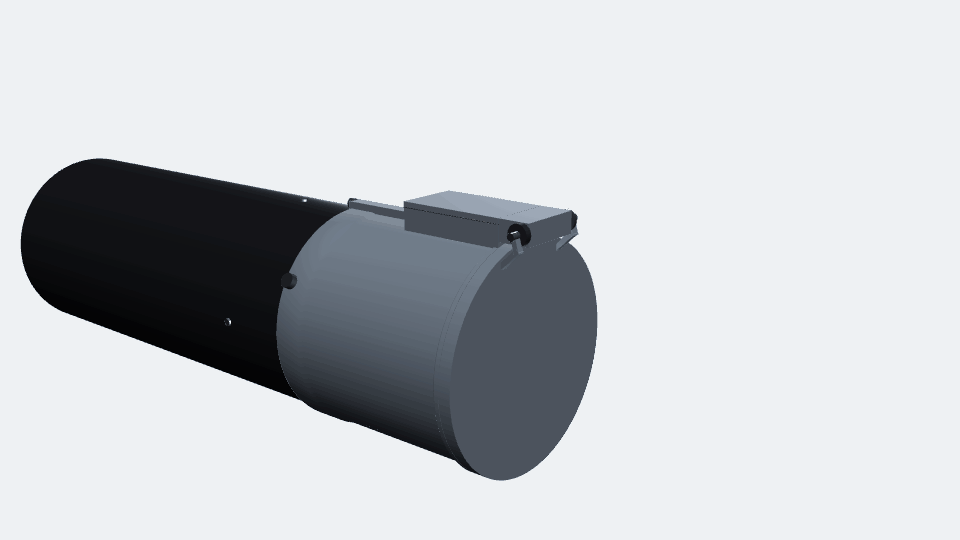
</p>

> [!NOTE]
> This project is in the **design phase** (Rev J). The drawings and the 3D model are concept-level. CAD files, the PCB and the build guide follow once the tube has been measured. See [Roadmap](#roadmap).

## Highlights

- **One block, one cable.** Servo, controller, EL inverter and sensors sit in a flat drive block on top of the shield. 12 V is the only external cable. It runs in a duct moulded into the shield wall.
- **Rim clamp instead of cable ties.** A U-profile slides over the tube rim. It is centred by an inner lip and fixed with screws in the holes of the original front ring, so nothing is drilled.
- **270° direct drive.** The servo shaft is the hinge axis. No linkage, no play, and the cover parks flat out of the light path.
- **Light-tight without force.** A lip on the cover overlaps the shield edge and forms a light labyrinth. Three small magnets only pull the cover flat.
- **Real cover state.** Hall sensors use the existing park and arm magnets, so the driver reports the measured `CoverState`, not an assumed one.
- **Dew control.** A BME280 measures the dew point and a heater channel warms the secondary mirror. On a Newtonian the secondary fogs first.
- **Printable in one piece.** The 225 mm shield fits upright on a 256 mm printer. Fine saw-tooth grooves inside suppress stray light, and no supports are needed.

## How it works

<p align="center">
  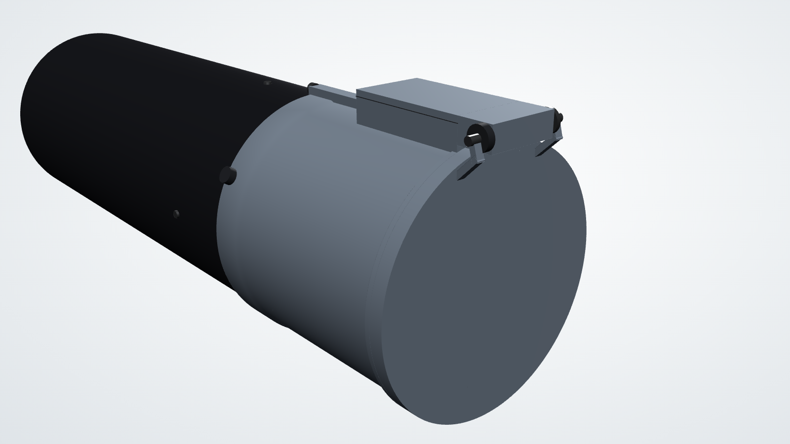
  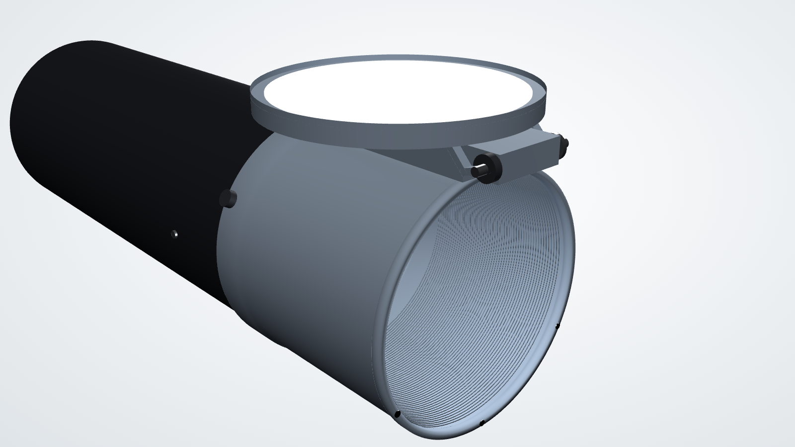
</p>
<p align="center">
  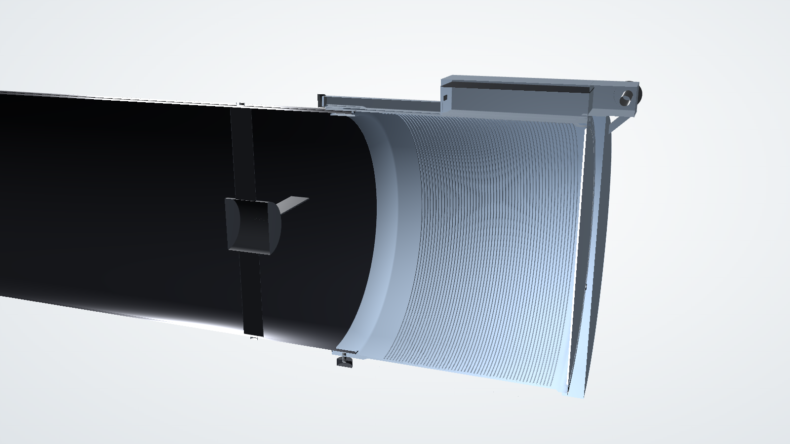
</p>

| Sheet | Shows |
|---|---|
| [Side view](docs/images/drawing-side-view.en.svg) | Overall dimensions, cable duct, light path, drive block |
| [Detail A – rim clamp](docs/images/drawing-detail-a-rim-clamp.en.svg) | U-profile, inner lip, screw into heat-set insert |
| [Detail B – magnets](docs/images/drawing-detail-b-magnets.en.svg) | Lip labyrinth, embedded magnet, steel disc |
| [Drive block](docs/images/drawing-drive-block.en.svg) | PCB, inverter, servo, Hall sensors, bearing |
| [Lid, exploded](docs/images/drawing-lid-exploded.en.svg) | Printed frame, carrier plate with EL foil, optional diffuser |
| [Front view](docs/images/drawing-front-view.en.svg) | Spider, screws, drive block at 12 o’clock |

<p align="center">
  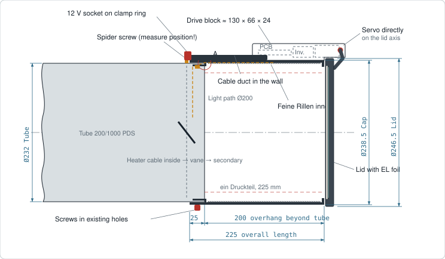
</p>

### Design sheet

The design sheet holds the 3D model, the concept comparison, parameters, all sheets and details, parts lists and the measurement list. It is in German.

- **Every section as an image:** [docs/en/design-sheet.md](docs/en/design-sheet.md)
- **Interactive in the browser** (rotate 3D, cutaway, lid angle): [https://lindekai.github.io/FlipFlat-Panel-2/design-sheet.html](https://lindekai.github.io/FlipFlat-Panel-2/design-sheet.html)

<p align="center">
  <a href="docs/en/design-sheet.md">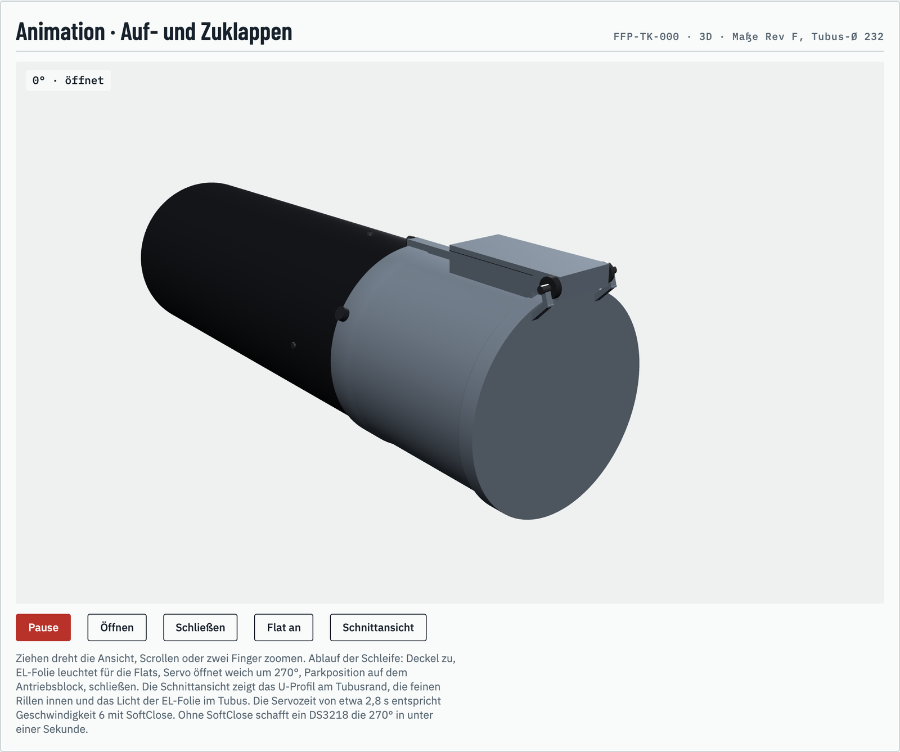</a>
  <a href="docs/en/design-sheet.md">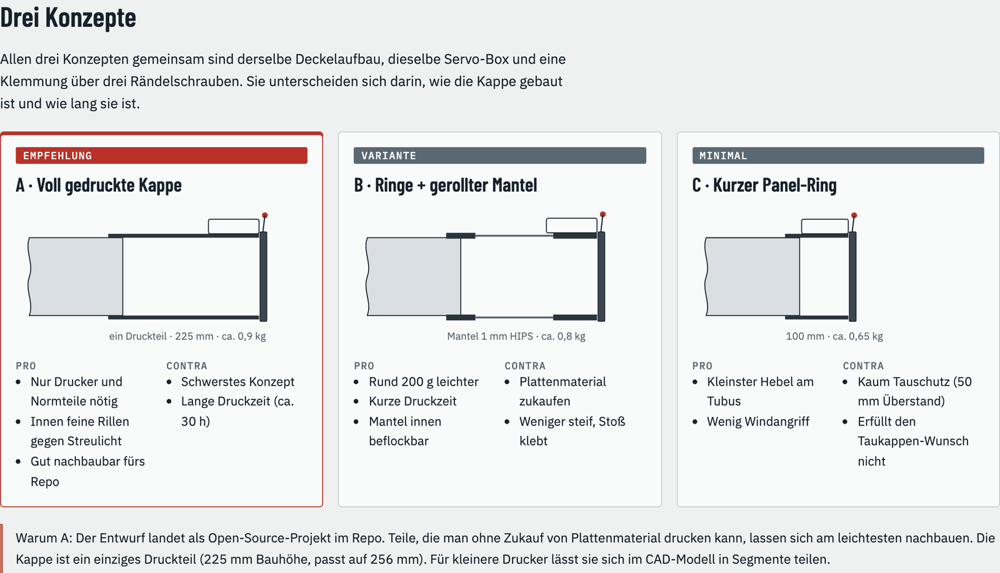</a>
</p>
<p align="center">
  <a href="docs/en/design-sheet.md">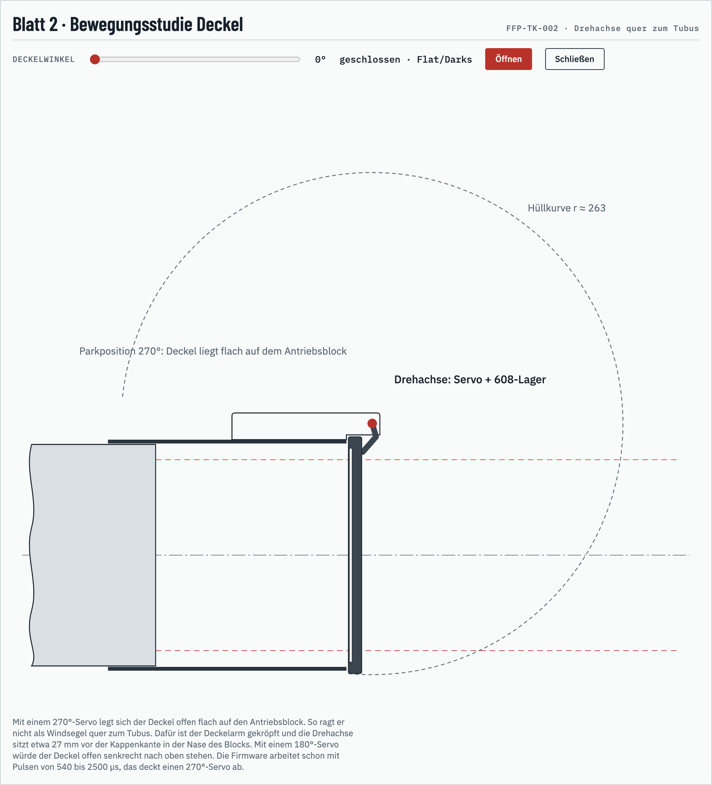</a>
  <a href="docs/en/design-sheet.md">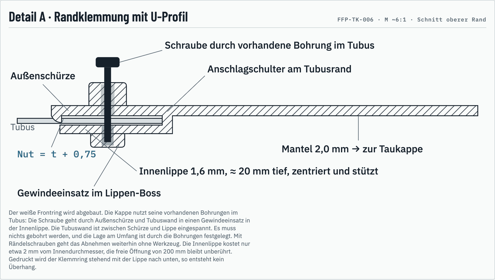</a>
  <a href="docs/en/design-sheet.md">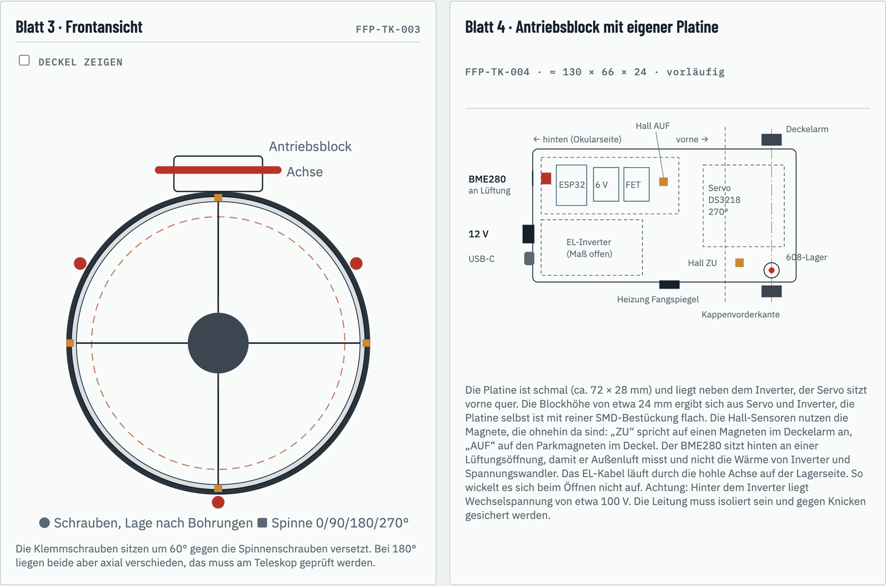</a>
</p>

## Key data

| | |
|---|---|
| Telescope | Skywatcher 200/1000 PDS (tube Ø ≈ 232 mm, to be measured) |
| Shield | 225 mm long, Ø ≈ 238.5 mm, 2 mm wall, PETG or ASA, one print |
| Cover | Ø ≈ 246.5 mm, printed frame + existing carrier plate with EL foil |
| Drive | DS3218MG servo, **270° version**, ≈ 20 kg·cm, 6 V |
| Drive block | ≈ 130 × 66 × 24 mm at 12 o’clock |
| Controller | ESP32-S3-MINI-1, ASCOM Alpaca over Wi-Fi, USB-C for service |
| Sensors | BME280 (dew point), 2 × Hall end stops |
| Outputs | EL inverter (PWM dimming), secondary heater |
| Power | 12 V DC, one cable |

All diameters follow from two measured values. See [Design → Parameters](docs/en/design.md#parameters).

## Documentation

| | English | Deutsch |
|---|---|---|
| Design sheet (all sections) | [docs/en/design-sheet.md](docs/en/design-sheet.md) | [docs/de/entwurfsblatt.md](docs/de/entwurfsblatt.md) |
| Design and decisions | [docs/en/design.md](docs/en/design.md) | [docs/de/design.md](docs/de/design.md) |
| Measuring the telescope | [docs/en/measuring.md](docs/en/measuring.md) | [docs/de/messen.md](docs/de/messen.md) |
| Build guide (draft) | [docs/en/build-guide.md](docs/en/build-guide.md) | [docs/de/bauanleitung.md](docs/de/bauanleitung.md) |
| Bill of materials | [hardware/BOM.md](hardware/BOM.md) | [hardware/BOM.md](hardware/BOM.md) |
| Firmware | [firmware/README.md](firmware/README.md) | [firmware/README.md](firmware/README.md) |

> The firmware in `firmware/` is the working v1.1 for an ESP32-WROOM-32 dev board (Alpaca, BME280, heater, Hall, SoftClose). It will be ported to the ESP32-S3 drive-block PCB.

## Repository layout

```text
FlipFlat-Panel-2/
├── docs/
│   ├── en/  de/            design, measuring guide, build guide
│   ├── images/             renderings, drawings (SVG, EN + DE), animation
│   └── design-sheet.html   interactive design sheet with 3D model
├── hardware/
│   ├── BOM.md              bill of materials
│   ├── cad/                parametric CAD model (planned)
│   └── pcb/                drive-block PCB (planned)
└── firmware/               ESP32 Alpaca firmware (imported with history)
```

## Roadmap

- [x] Concept, rim clamp, drive and seal (Rev A–J)
- [x] Drawings, 3D model and motion study
- [ ] Measure the tube and update the parameters ([guide](docs/en/measuring.md))
- [ ] Parametric CAD model (OpenSCAD) and STL export
- [ ] Test prints: clamp section and magnet test ring
- [ ] Drive-block PCB (ESP32-S3, 6 V buck, 2 × MOSFET, Hall, BME280)
- [ ] Port the firmware to the new PCB, then the Alpaca ConformU test
- [ ] Build guide with photos

## Credits

The original FlipFlat concept, circuit and hardware design are by **Moritz Mayer** from the [Dark Matters Discord](https://discord.gg/darkmatters). This project builds on it. The rim clamp was inspired by the Strato dew shields from 3D-Druck Krug. The geometry here is our own.

## License

[MIT](LICENSE) © 2026 Kai Linde. This covers the hardware designs, documentation and firmware.
