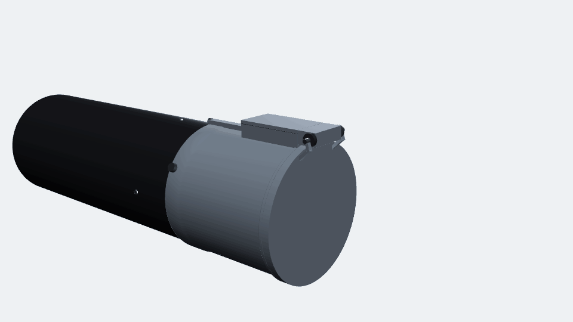

# Bauanleitung

[English](../en/build-guide.md) · **Deutsch**

> [!IMPORTANT]
> **Entwurf.** Diese Anleitung beschreibt den geplanten Ablauf. Sie wird mit Fotos ergänzt, sobald CAD-Dateien und Platine fertig und die Testdrucke gemacht sind. Maße hier gelten für D = 232 mm und t = 1 mm.

## Überblick

| Schritt | Dauer (ca.) |
|---|---|
| 1 · Teleskop vermessen | 30 min |
| 2 · Testdrucke | 3 h Druck |
| 3 · Kappe drucken | 25–30 h Druck |
| 4 · Antriebsblock und Deckel drucken | 8 h Druck |
| 5 · Magnete und Gewindeeinsätze setzen | 30 min |
| 6 · Elektronik bestücken und flashen | 1–2 h |
| 7 · Montage | 1 h |
| 8 · Einrichten in N.I.N.A. | 15 min |

## 1 · Teleskop vermessen

Siehe [Messanleitung](messen.md). Die Werte werden im CAD-Modell eingetragen, und daraus entstehen die STL-Dateien.

## 2 · Testdrucke

Bevor 30 Stunden Druck starten, zwei kleine Teile prüfen:

- **Klemmring-Abschnitt** (ca. 40 mm hoch): Er muss stramm auf den Tubusrand gehen, ohne zu klemmen. Bei Bedarf die Nutbreite im Modell um ±0,1 mm anpassen.
- **Magnet-Testring** mit verschiedenen Deckschichten (0,4 / 0,6 / 0,8 mm): Der Deckel soll spürbar plan gezogen werden, sich aber mit einem Finger leicht öffnen lassen.

## 3 · Kappe drucken

| Einstellung | Wert |
|---|---|
| Material | PETG oder ASA, schwarz matt |
| Ausrichtung | stehend, Klemmring unten |
| Wände | 4 Perimeter (2,0 mm bei 0,45 mm Linienbreite) |
| Schichthöhe | 0,2 mm, im Rillenbereich ruhig 0,16 mm |
| Stützen | keine |
| Druckpause | auf Höhe der Magnettaschen (wird im Slicer markiert) |

Die Rillen innen haben eine 45°-Flanke nach unten und drucken deshalb ohne Stützen. In der Druckpause die drei Magnete einlegen, **Polung vorher mit dem Deckel prüfen**.

## 4 · Antriebsblock und Deckel

- Antriebsblock: Unterteil und Deckel, liegend.
- Deckelrahmen: liegend mit der Lippe nach oben. Druckpause für die Stahlscheiben.
- Deckelarme: liegend, 100 % Infill. Sie tragen das ganze Moment.

## 5 · Einsätze und Magnete

- Gewindeeinsätze mit dem Lötkolben (ca. 220 °C) in die Bosse der Innenlippe setzen.
- Parkmagnete in den Block, einen Magneten in den Deckelarm. Diese lösen die Hall-Endlagen aus.

## 6 · Elektronik

- Platine bestücken (oder bestückt bestellen), siehe [`hardware/pcb`](../../hardware/pcb/).
- Firmware flashen, siehe [`firmware/README.md`](../../firmware/README.md).
- **Servo vor dem Einbau auf Mittelstellung fahren**, erst dann das Servohorn klemmen.

> [!WARNING]
> Der EL-Inverter erzeugt rund 100 V Wechselspannung. Die Leitung durch die Achse muss isoliert und gegen Knicken gesichert sein. Nur bei abgezogenem 12-V-Stecker arbeiten.

## 7 · Montage

1. Weißen Frontring abbauen.
2. Kappe aufstecken, Block bei 12 Uhr. Die Innenlippe zentriert sie von selbst.
3. Schrauben durch die vorhandenen Bohrungen in die Gewindeeinsätze drehen.
4. Heizkabel innen an der Strebe zum Fangspiegel führen, Stecker an der Lippe verbinden.
5. Antriebsblock auf die Schwalbenschwanzschiene schieben und sichern.
6. Tubus neu ausbalancieren. Vorne kommt etwa 1 kg dazu.

## 8 · Einrichten

1. Beim ersten Start öffnet der ESP32 einen eigenen WLAN-Zugangspunkt. Dort das heimische WLAN eintragen.
2. Im Web-Interface die Endlagen kalibrieren: ZU und AUF (270°).
3. In N.I.N.A. unter *Ausrüstung → Flat-Panel* das Alpaca-Gerät auswählen. Es wird automatisch gefunden.
