# Entwurfsblatt

Alle Abschnitte des interaktiven Entwurfsblatts als Bilder. **Interaktiv** (3D-Modell drehen, Schnittansicht, Deckelwinkel per Schieberegler): [`design-sheet.html`](../design-sheet.html) herunterladen und im Browser öffnen.

## Inhalt

- [3D-Modell · Auf- und Zuklappen](#1)
- [Ausgangslage](#2)
- [Ist-Stand und was Rev B ändert](#3)
- [Drei Konzepte](#4)
- [Parameter](#5)
- [Blatt 1 · Seitenansicht, geschlossen](#6)
- [Detail A · Randklemmung mit U-Profil](#7)
- [Blatt 2 · Bewegungsstudie Deckel](#8)
- [Blatt 3 + 4 · Frontansicht und Antriebsblock](#9)
- [Blatt 5 · Deckel, Explosionsdarstellung](#10)
- [Detail B · Magnetschluss und Lichtlabyrinth](#11)
- [Druckteile und Zukaufteile](#12)
- [Tau am Newton · Elektrik prüfen](#13)
- [Messliste am Teleskop](#14)

## 3D-Modell · Auf- und Zuklappen

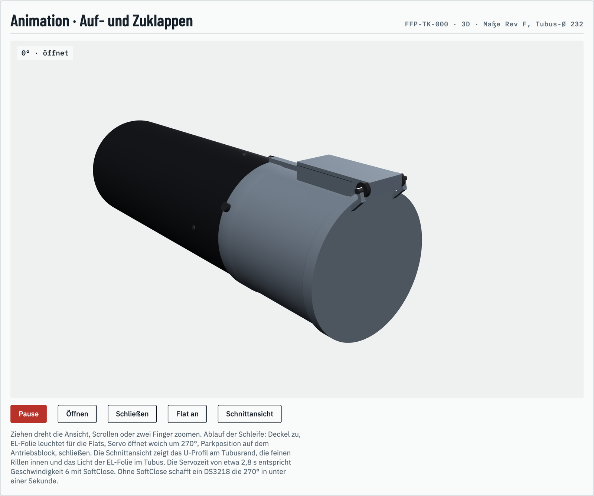

## Ausgangslage

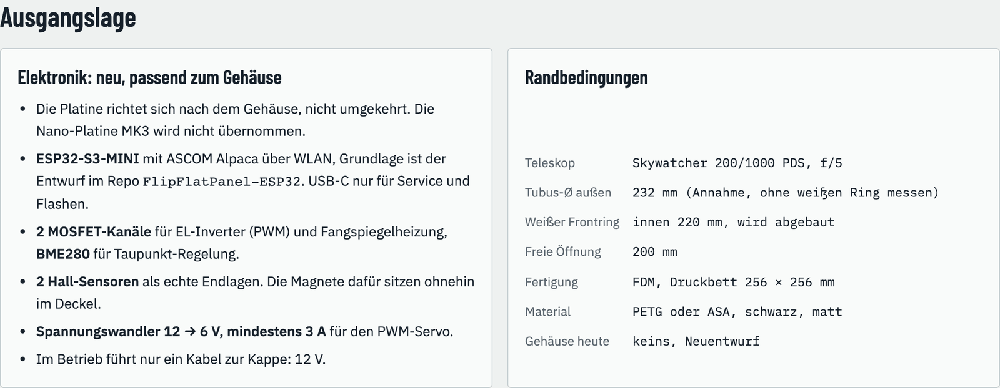

## Ist-Stand und was Rev B ändert

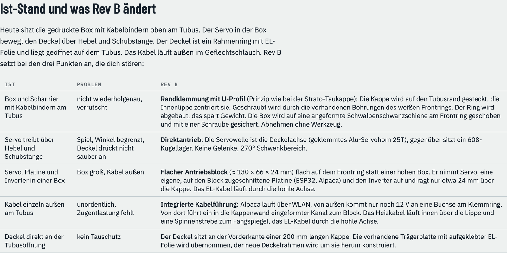

## Drei Konzepte

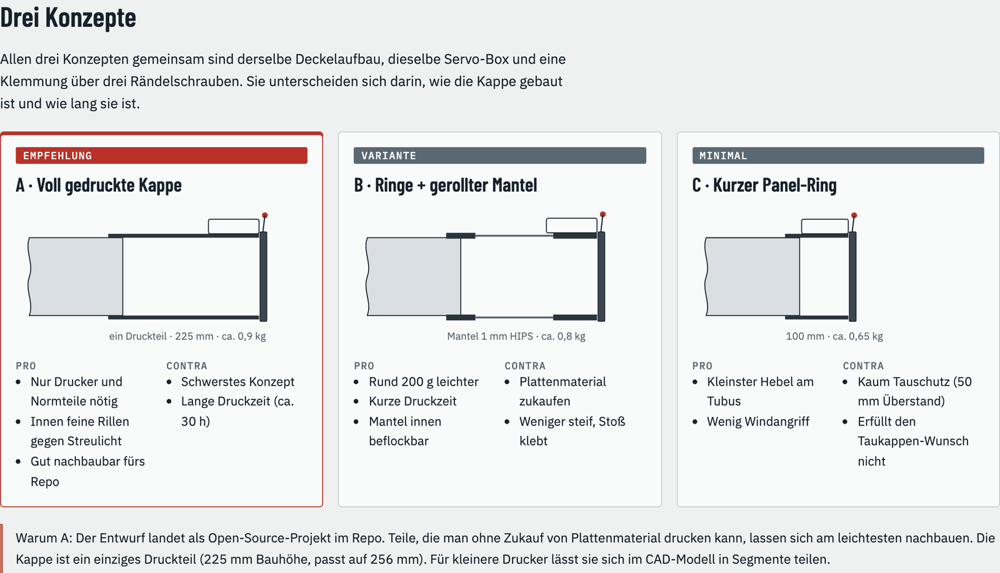

## Parameter

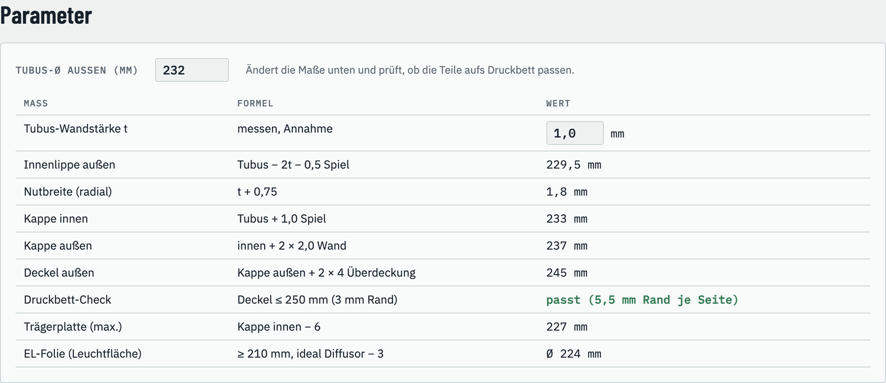

## Blatt 1 · Seitenansicht, geschlossen

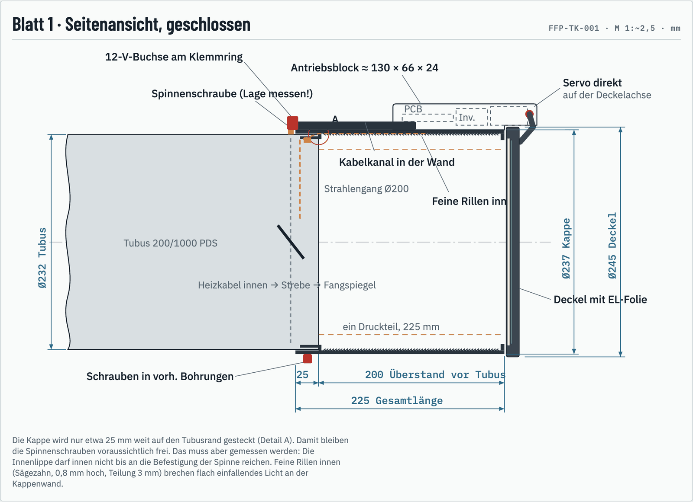

## Detail A · Randklemmung mit U-Profil

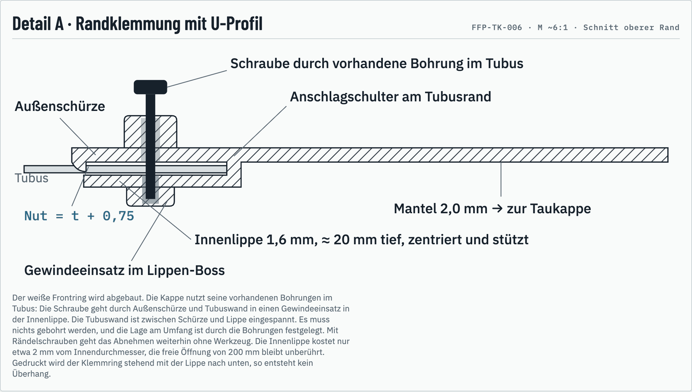

## Blatt 2 · Bewegungsstudie Deckel

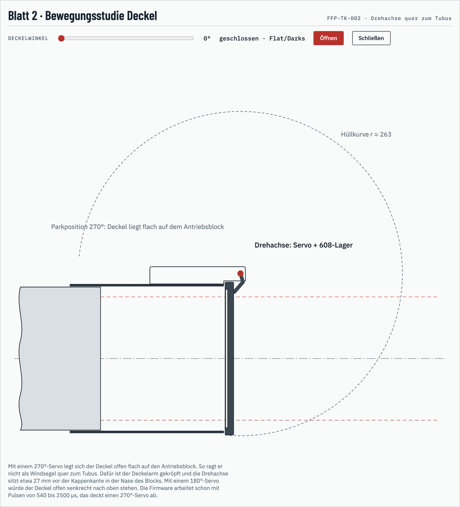

## Blatt 3 + 4 · Frontansicht und Antriebsblock

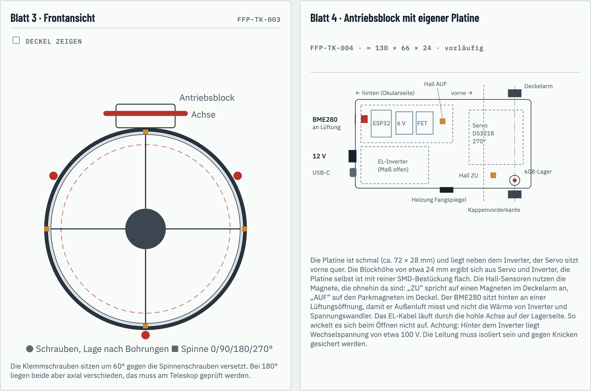

## Blatt 5 · Deckel, Explosionsdarstellung

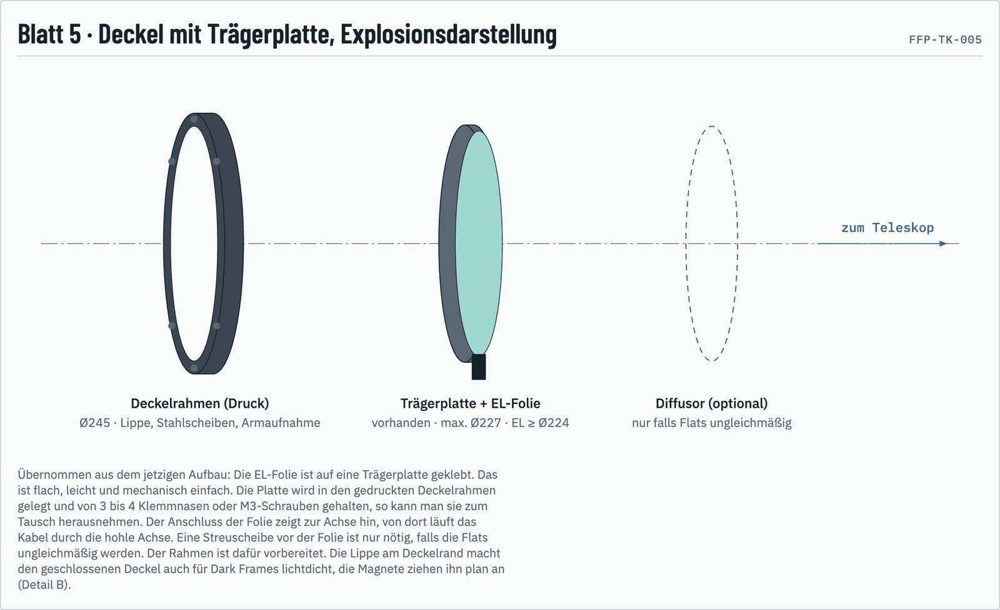

## Detail B · Magnetschluss und Lichtlabyrinth

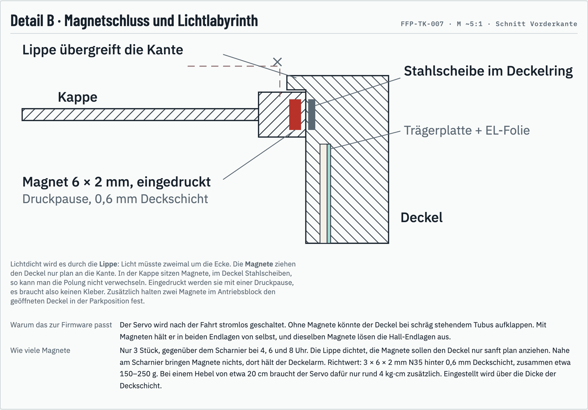

## Druckteile und Zukaufteile

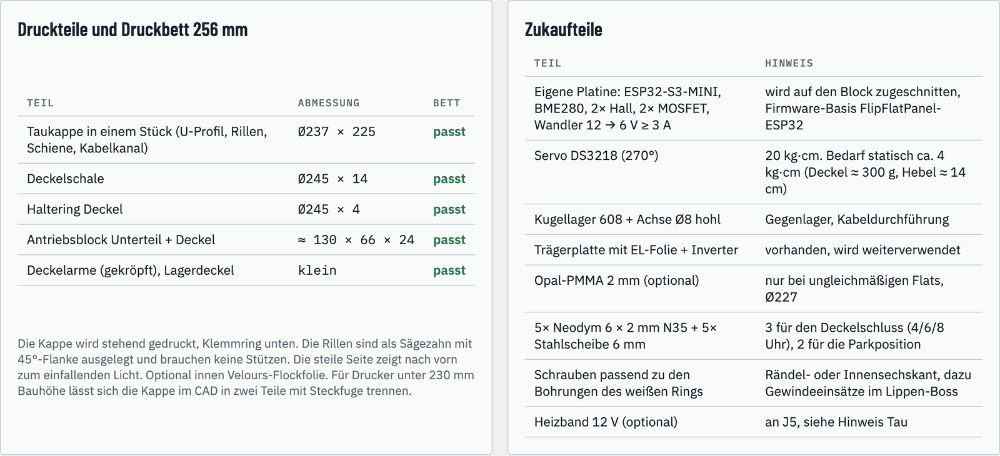

## Tau am Newton · Elektrik prüfen

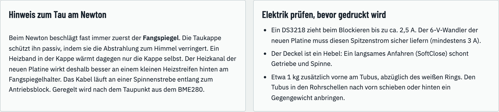

## Messliste am Teleskop

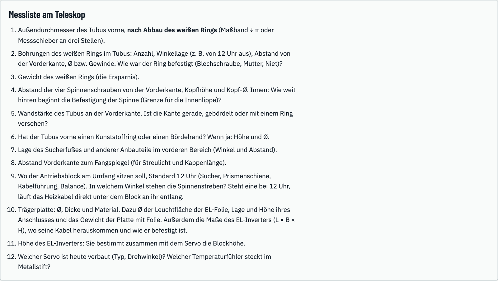
