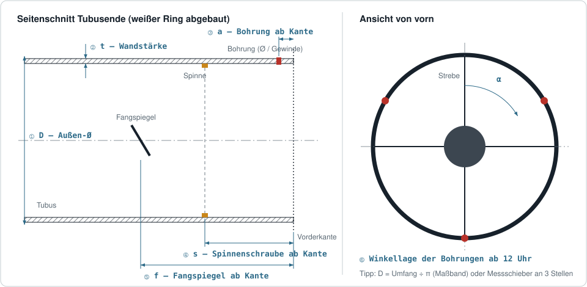

# Teleskop vermessen

<sub>[English](../en/measuring.md) · **Deutsch**</sub>

Alle Maße der Taukappe hängen an wenigen Werten des eigenen Tubus. Diese Anleitung zeigt, was gemessen wird und wie. Rechne mit etwa 30 Minuten.



## Du brauchst

- Messschieber (digital, 150 mm reicht)
- Flexibles Maßband (Schneidermaßband)
- Küchenwaage
- Kreuzschlitz- und Innensechskantschlüssel für die Schrauben des Frontrings
- Kreppband und Stift zum Markieren
- Handy für Fotos

> [!CAUTION]
> Den Tubus vorher **waagerecht** lagern, mit der Öffnung leicht nach unten. Dann fällt nichts auf den Hauptspiegel. Den Fangspiegel nicht berühren.

## 1 · Weißen Frontring abbauen

1. Den Ring vor dem Lösen mit Kreppband bei **12 Uhr** markieren, mit Blick von vorn auf den Tubus. Alle Winkel unten beziehen sich auf diese Marke.
2. Schrauben lösen und aufheben.
3. Ring abnehmen und **wiegen** (Wert ③ in der Tabelle unten).
4. Fotos machen: Ring von beiden Seiten, Tubusvorderkante, eine Bohrung in Nahaufnahme.

## 2 · Außendurchmesser D

Das ist das wichtigste Maß. Die Innenlippe und das U-Profil werden daraus berechnet.

- **Maßband:** Den Umfang etwa 10 mm hinter der Vorderkante messen, dann D = Umfang ÷ π. Beispiel: 729 mm ÷ 3,1416 = 232,0 mm.
- **Messschieber:** Mit den großen Schnäbeln an drei Stellen messen, um 60° versetzt. Den Mittelwert nehmen. Weichen die Werte mehr als 1 mm voneinander ab, ist der Tubus leicht oval. Dann alle drei Werte notieren.

## 3 · Wandstärke t

Mit den Schnäbeln des Messschiebers direkt an der Vorderkante messen. Ist die Kante **gebördelt** oder umgebogen, ein Foto im Profil machen und die Wandstärke 20 mm weiter hinten an einer Bohrung messen.

## 4 · Bohrungen des Frontrings

Für jede Bohrung notieren:

| | Wie |
|---|---|
| Winkel α | ab der 12-Uhr-Marke im Uhrzeigersinn, mit Blick von vorn. Am einfachsten über den Bogen mit dem Maßband: α = Bogenlänge ÷ Umfang × 360° |
| Abstand a | von der Vorderkante bis zur Bohrungsmitte |
| Ø bzw. Gewinde | Loch-Ø mit dem Messschieber. Steckt eine Mutter oder ein Gewinde im Tubus? Typ der Schraube (Blechschraube, M4, M5 …) |

## 5 · Spinne und Fangspiegel

- **s:** Abstand von der Vorderkante bis zur Mitte der Spinnenschrauben außen am Tubus. Die Innenlippe der Kappe muss davor enden.
- **f:** Abstand von der Vorderkante bis zur Mitte des Fangspiegels. Das geht von innen mit dem Tiefenmaß des Messschiebers oder mit einem Lineal quer über die Öffnung.
- **Winkel der Streben:** Steht eine Strebe bei 12 Uhr? Daran läuft später das Heizkabel.

## 6 · Trägerplatte, EL-Folie und Inverter

| Teil | Werte |
|---|---|
| Trägerplatte | Ø, Dicke, Material, Gewicht |
| EL-Folie | Ø der Leuchtfläche, Lage und Höhe des Anschlusses |
| Inverter | L × B × H, wo die Kabel herauskommen, Befestigung (Laschen, Löcher) |

## 7 · Lage am Tubus

Wo sitzen Sucher, Prismenschiene und Okularauszug, jeweils als Uhrzeit von vorn gesehen? Der Antriebsblock soll bei 12 Uhr sitzen, ohne mit etwas zu kollidieren.

## Messblatt

Die Werte am einfachsten in ein Issue mit der Vorlage **„Messwerte“** eintragen oder hier kopieren:

```text
① D Außen-Ø (ohne Ring):        ___ mm   (Umfang: ___ mm)
② t Wandstärke:                  ___ mm   Kante gerade / gebördelt
③ Gewicht weißer Ring:           ___ g
④ Bohrungen: Anzahl ___
   α: ___° ___° ___°   a: ___ mm   Ø/Gewinde: ___   Schraube: ___
⑤ s Spinnenschraube ab Kante:    ___ mm
⑥ f Fangspiegel ab Kante:        ___ mm   Strebe bei 12 Uhr: ja / nein
⑦ Trägerplatte Ø/Dicke/Gewicht:  ___ / ___ / ___   Leuchtfläche Ø: ___
⑧ Inverter L×B×H:                ___ × ___ × ___ mm
⑨ Sucher / Schiene / OAZ (Uhr):  ___ / ___ / ___
```
