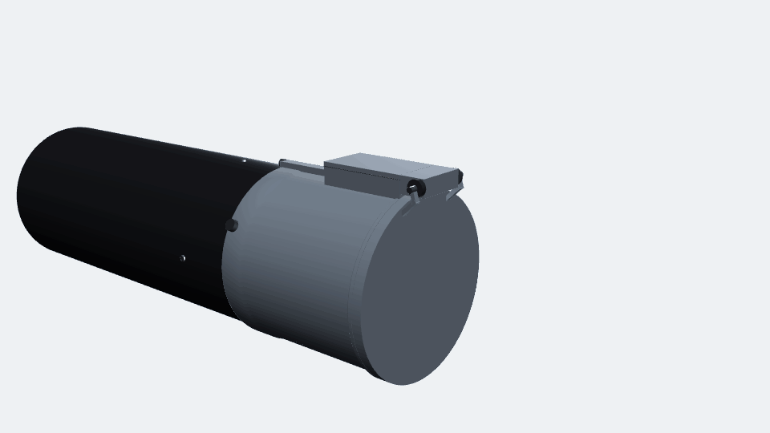

# Build guide

**English** · [Deutsch](../de/bauanleitung.md)

> [!IMPORTANT]
> **Draft.** This guide describes the planned process. Photos will be added once the CAD files and PCB are done and the test prints are made. Dimensions here are for D = 232 mm and t = 1 mm.

## Overview

| Step | Time (approx.) |
|---|---|
| 1 · Measure the telescope | 30 min |
| 2 · Test prints | 3 h printing |
| 3 · Print the shield | 25–30 h printing |
| 4 · Print the drive block and cover | 8 h printing |
| 5 · Fit magnets and heat-set inserts | 30 min |
| 6 · Assemble and flash the electronics | 1–2 h |
| 7 · Mount | 1 h |
| 8 · Set up in N.I.N.A. | 15 min |

## 1 · Measure the telescope

See the [measuring guide](measuring.md). The values go into the CAD model, which then produces the STL files.

## 2 · Test prints

Before starting a 30-hour print, check two small parts:

- **Clamp section** (about 40 mm high): It should slide firmly onto the tube rim without binding. If needed, adjust the slot width in the model by ±0.1 mm.
- **Magnet test ring** with different skins (0.4 / 0.6 / 0.8 mm): The cover should be pulled noticeably flat but open easily with one finger.

## 3 · Print the shield

| Setting | Value |
|---|---|
| Material | PETG or ASA, matte black |
| Orientation | upright, clamp end down |
| Walls | 4 perimeters (2.0 mm at 0.45 mm line width) |
| Layer height | 0.2 mm; 0.16 mm in the groove zone is fine |
| Supports | none |
| Pause | at the height of the magnet pockets (marked in the slicer) |

The inner grooves have a 45° flank facing down, so they print without supports. Insert the three magnets during the pause, **checking polarity against the cover first**.

## 4 · Drive block and cover

- Drive block: base and lid, printed flat.
- Cover frame: flat with the lip facing up, with a pause for the steel discs.
- Cover arms: flat, 100 % infill. They carry the full torque.

## 5 · Inserts and magnets

- Press the heat-set inserts into the bosses of the inner lip with a soldering iron (about 220 °C).
- Fit the park magnets into the block and one magnet into the cover arm. They trigger the Hall end stops.

## 6 · Electronics

- Assemble the PCB, or order it assembled. See [`hardware/pcb`](../../hardware/pcb/).
- Flash the firmware. See [`firmware/README.md`](../../firmware/README.md).
- **Move the servo to centre before fitting it**, and only then clamp the servo horn.

> [!WARNING]
> The EL inverter produces about 100 V AC. The lead through the axis must be insulated and protected against kinking. Only work with the 12 V plug disconnected.

## 7 · Mounting

1. Remove the white front ring.
2. Slide the shield on with the block at 12 o’clock. The inner lip centres it.
3. Drive the screws through the existing holes into the heat-set inserts.
4. Route the heater cable inside along the vane to the secondary, and connect the plug at the lip.
5. Slide the drive block onto the dovetail rail and secure it.
6. Rebalance the tube. About 1 kg is added at the front.

## 8 · Set-up

1. On first start the ESP32 opens its own Wi-Fi access point. Enter your home network there.
2. Calibrate the end positions in the web interface: CLOSED and OPEN (270°).
3. In N.I.N.A., select the Alpaca device under *Equipment → Flat Panel*. It is discovered automatically.
