# Design sheet

Every section of the interactive design sheet as an image. The sheet itself is in German. **Interactive** (rotate the 3D model, cutaway, lid angle slider): [https://lindekai.github.io/FlipFlat-Panel-2/design-sheet.html](https://lindekai.github.io/FlipFlat-Panel-2/design-sheet.html) · Source: [`design-sheet.html`](../design-sheet.html)

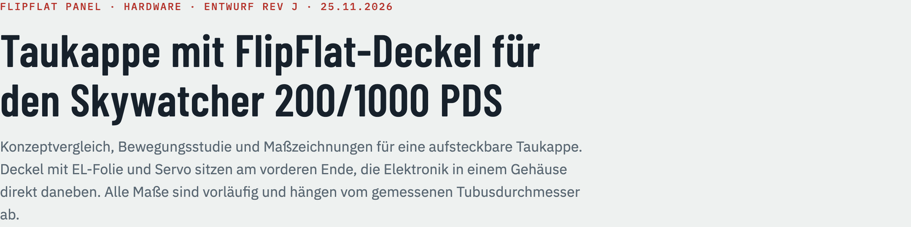

## Contents

- [3D model · opening and closing](#1)
- [Starting point](#2)
- [Current state and what Rev B changes](#3)
- [Three concepts](#4)
- [Parameters](#5)
- [Sheet 1 · side view, closed](#6)
- [Detail A · rim clamp with U-profile](#7)
- [Sheet 2 · lid motion study](#8)
- [Sheets 3 + 4 · front view and drive block](#9)
- [Sheet 5 · lid, exploded view](#10)
- [Detail B · magnetic closure and light labyrinth](#11)
- [Printed and purchased parts](#12)
- [Dew on a Newtonian · check the electrics](#13)
- [Measurement list](#14)

## 3D model · opening and closing

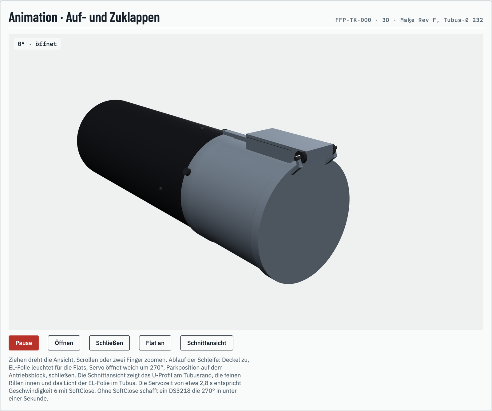

## Starting point

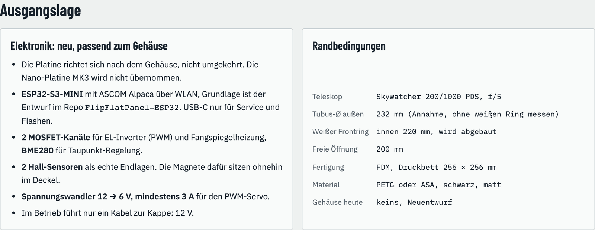

## Current state and what Rev B changes

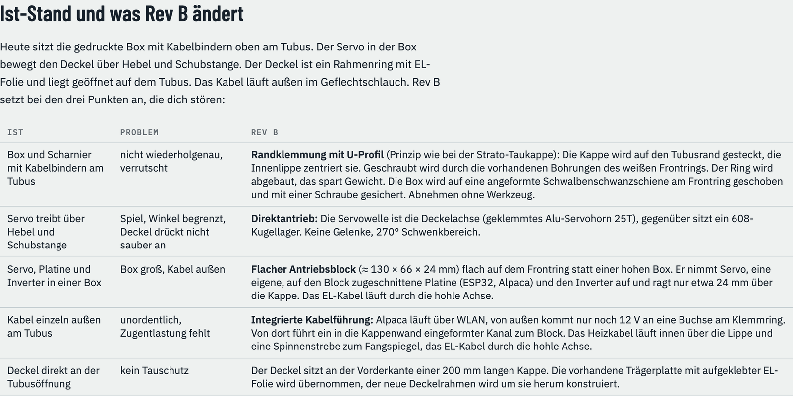

## Three concepts

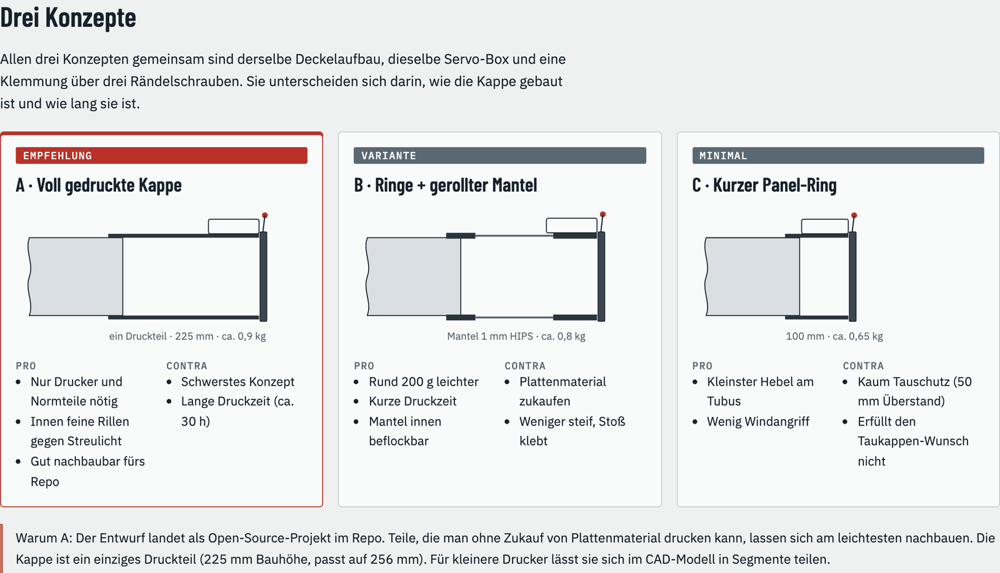

## Parameters

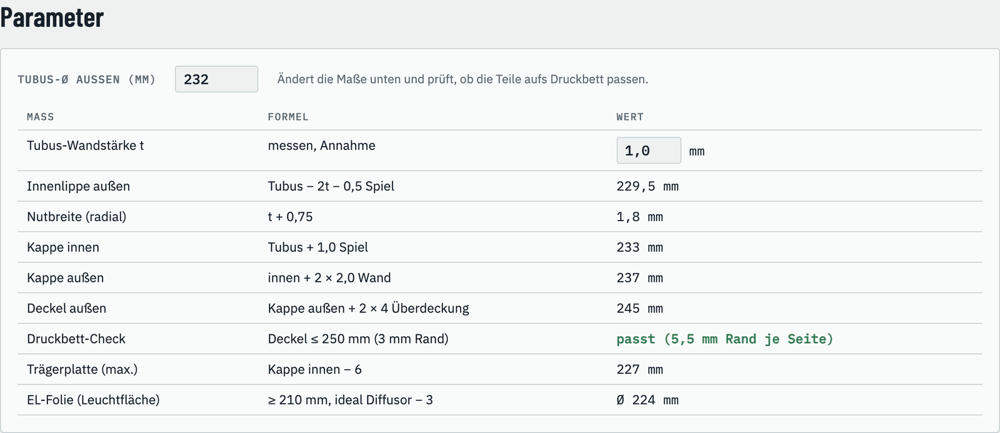

## Sheet 1 · side view, closed

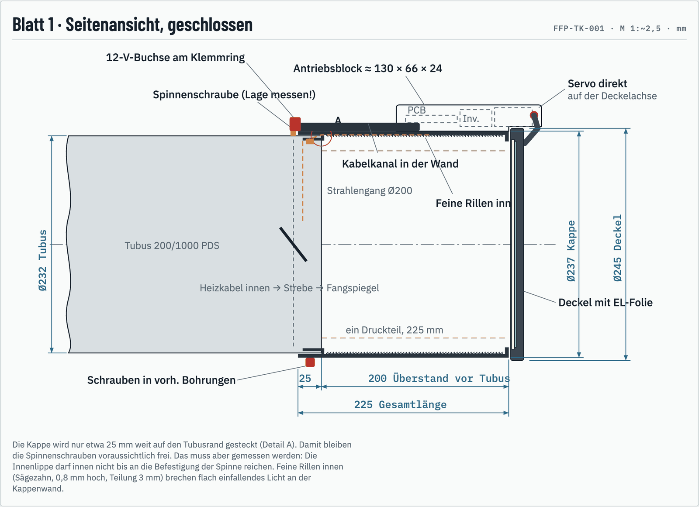

## Detail A · rim clamp with U-profile

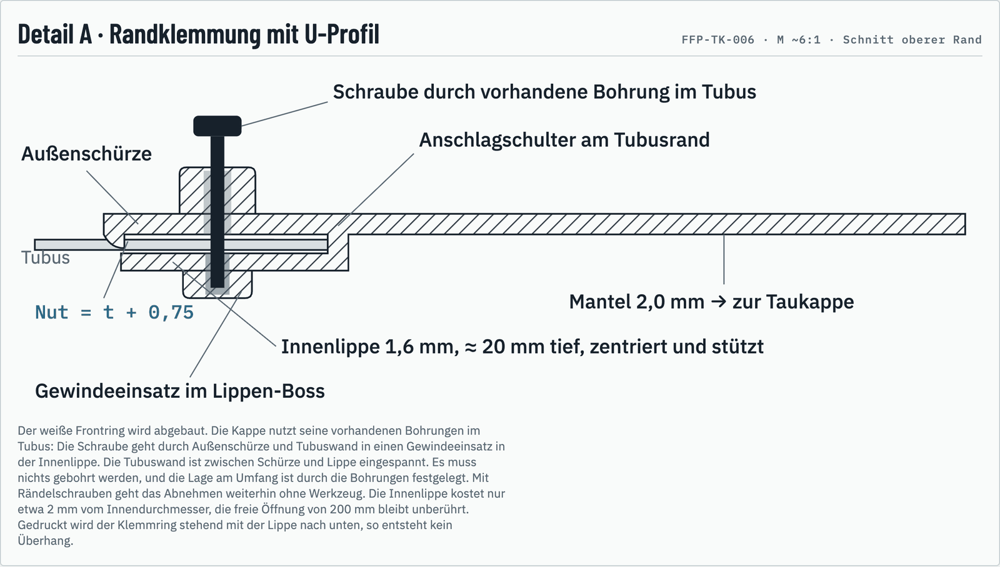

## Sheet 2 · lid motion study

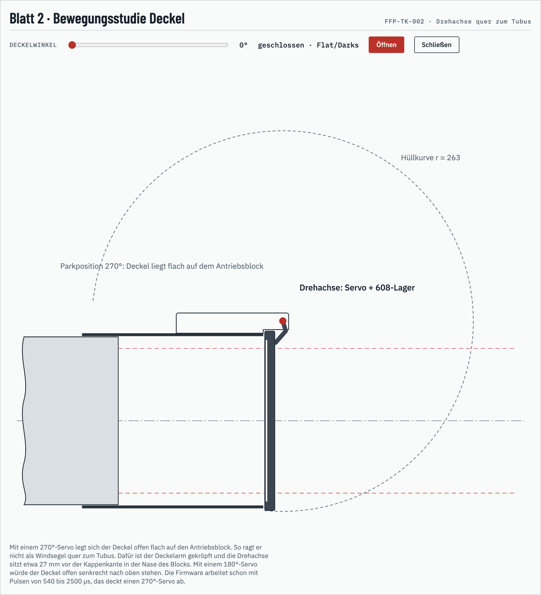

## Sheets 3 + 4 · front view and drive block

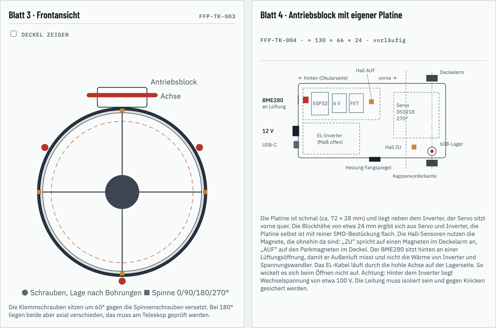

## Sheet 5 · lid, exploded view

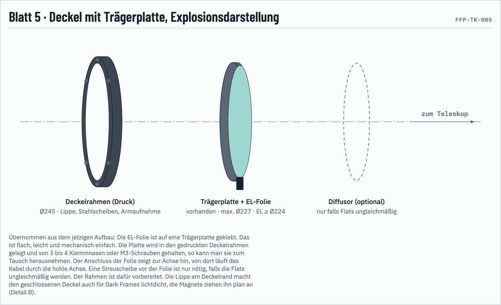

## Detail B · magnetic closure and light labyrinth

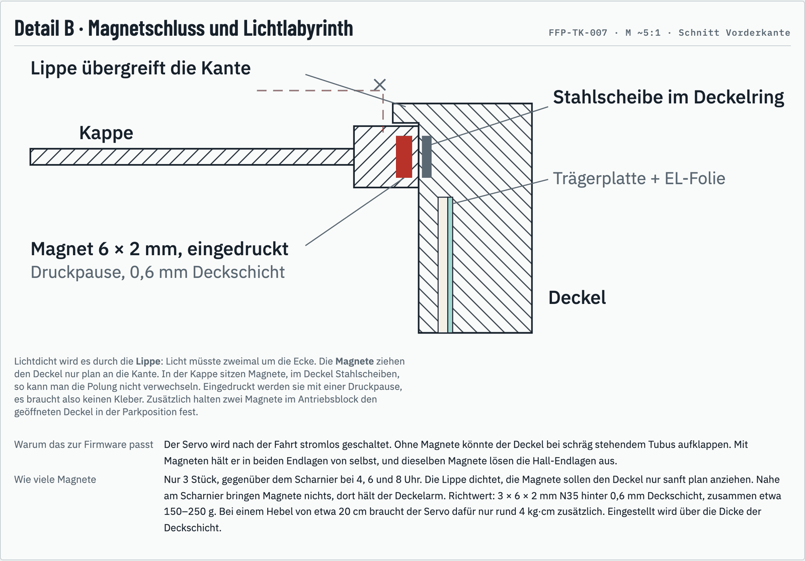

## Printed and purchased parts

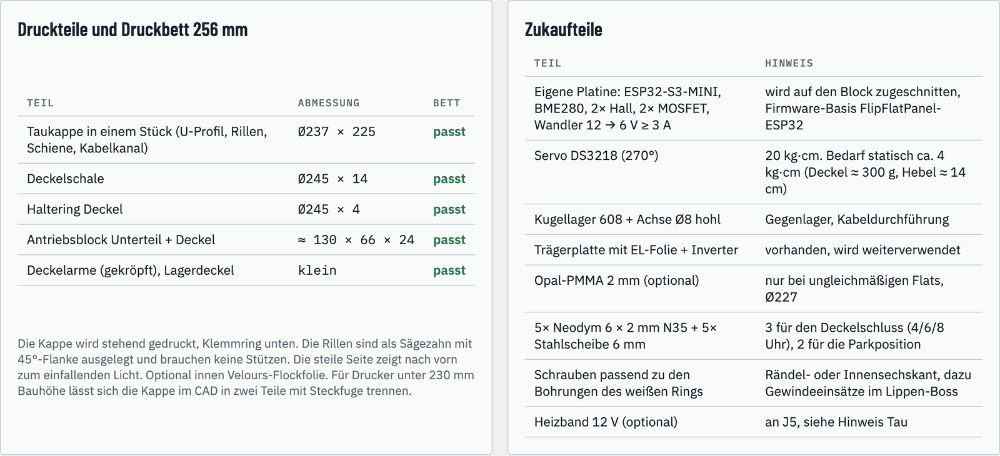

## Dew on a Newtonian · check the electrics

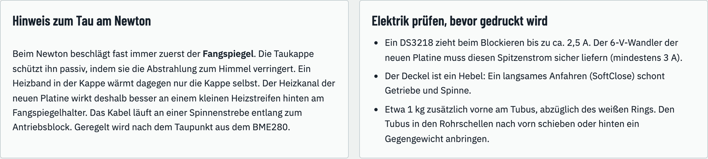

## Measurement list

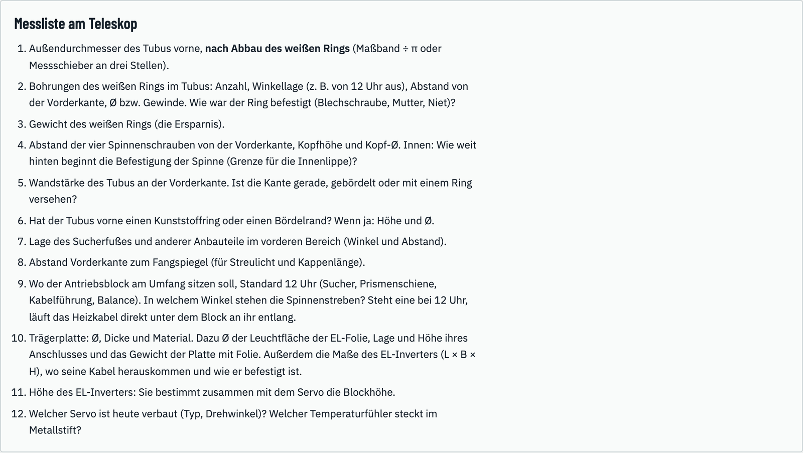
