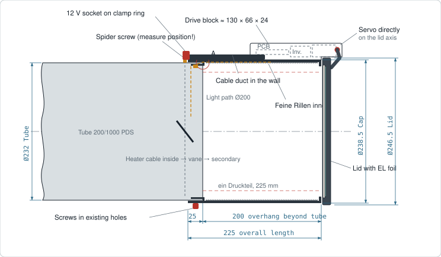
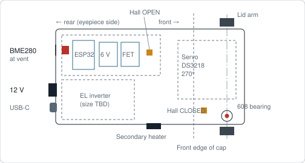

# Design: dew shield with FlipFlat cover

**English** · [Deutsch](../de/design.md)

Revision J · 25 Nov 2026 · Status: **design agreed, measurements pending**

The interactive design sheet with dimensioned drawings, a motion study and a 3D model is [`docs/design-sheet.html`](../design-sheet.html). It is in German.

## Goal

The existing FlipFlat panel becomes a dew shield with an integrated flat-field cover. It mounts on the front of a Skywatcher 200/1000 PDS tube. The focus is the housing, and the dew shield comes as a side benefit. The electronics are designed new to fit the housing (ESP32, ASCOM Alpaca). They do not follow the existing Arduino Nano board.

## Starting point and problems

| Today | Problem |
|---|---|
| Printed box held to the tube with cable ties | not repeatable, slips |
| Servo in the box moves the cover via lever and push rod | play, limited angle |
| Servo, PCB and inverter in one large box, cables outside in braided sleeve | bulky, untidy cabling |
| Cover directly on the tube opening | no dew protection |

This works well and is kept: **the EL foil glued to a carrier plate**. It is flat, light and mechanically simple.

## Decisions

1. **Fully printed shield, one part.** It is 225 mm long with an outer Ø of about 238.5 mm. It fits upright on a printer with 256 mm build height and is printed clamp end down. Material is PETG or ASA, matte black, with a 2.0 mm wall.
   - **Stray light:** Instead of baffle rings, the inner wall has fine circumferential saw-tooth grooves, 0.8 mm high at a 3 mm pitch. The 45° flank faces down, so no supports are needed. The steep face points forward towards incoming light. Velvet flocking foil can be added inside as an option.
   - For printers with less than 230 mm build height, the CAD model can split the shield into two parts with a spigot joint.
2. **Mounting: rim clamp with U-profile** (see [Detail A](../images/drawing-detail-a-rim-clamp.en.svg)). The principle is similar to the Strato dew shields from 3D-Druck Krug, with our own geometry.
   - The tube’s white front ring (inner Ø 220 mm) is **removed**.
   - The inner lip (1.6 mm, about 20 mm deep) enters the tube and centres the shield. The outer skirt rests outside, and the shoulder sits on the front edge.
   - Screws go through the **existing holes of the white ring** into heat-set inserts in bosses on the inner lip. Nothing is drilled, and the angular positions are given by the tube.
   - Overlap is 25 mm, and the shield projects 200 mm beyond the tube.
3. **Drive block** lies flat on the shield at 12 o’clock. It is provisionally about 130 × 66 × 24 mm; the height follows from the servo and inverter. It holds the servo, a custom PCB (ESP32, Alpaca) and the EL inverter, see [Electronics in the drive block](#electronics-in-the-drive-block).
   - A nose projects about 35 mm beyond the shield edge and carries the hinge axis.
   - 12 V arrives through the cable duct in the shield wall. USB-C at the rear is for service only.
   - The block slides onto a dovetail rail on the shield and is secured with one screw.
4. **Direct drive, 270°.** The servo shaft is the hinge axis, with a clamped aluminium 25T servo horn. A 608 ball bearing sits on the opposite side. The axis is hollow, and the EL cable runs through it. The cover arm is cranked, so the open cover parks flat on the block.
   - Servo: DS3218 (270°, ≈ 20 kg·cm). The static requirement is about 4 kg·cm for a cover of about 300 g.
   - It is a standard PWM servo, powered by a buck converter on the custom PCB (6 V, at least 3 A).
5. **Cover**: a printed frame (Ø ≈ shield outer + 8 mm) and the existing carrier plate with EL foil. The plate is removable, held by clips or M3 screws. An opal PMMA diffuser is optional. See the [exploded view](../images/drawing-lid-exploded.en.svg).
6. **Light seal by lip and magnets** (see [Detail B](../images/drawing-detail-b-magnets.en.svg)):
   - A lip on the cover rim overlaps the shield edge and forms a light labyrinth.
   - Only **3 magnets** (NdFeB 6 × 2 mm, N35) sit in the shield edge opposite the hinge, at 4, 6 and 8 o’clock (hinge at 12). They are embedded during a print pause under a 0.6 mm skin. Steel discs in the cover frame act as counterparts.
   - The magnets only pull the cover flat; the lip makes it light-tight. Together they pull about 150–250 g, which adds about 4 kg·cm for the servo when opening.
   - 2 more magnets hold the open cover in the park position. They are needed because the servo is switched off after each move. The park magnets and a magnet in the cover arm also trigger the Hall end stops.
   - The holding force is tuned with a test ring by varying the skin thickness.
7. **Dew**: On a Newtonian the secondary mirror fogs first. A heater channel on the new PCB powers a heater strip on the secondary holder. It is regulated by the dew point from the BME280.
8. **One block, integrated cabling.** There is no front/rear split and there are no loose single cables.
   - All electronics (ESP32, buck converter, MOSFETs, inverter, servo, sensors) stay **in one block** on the shield.
   - **12 V** is the only external cable. It plugs into a panel socket at the rear end of the clamp ring (12 o’clock). From there a **cable duct** moulded into the shield wall (about 14 × 9 mm outside) runs to the block.
   - **Secondary heater cable:** It passes through the shield wall below the block, runs inside along the wall to the lip and then along a spider vane to the secondary. A small connector at the lip keeps the shield removable.
   - **EL cable:** runs through the hollow hinge axis.
   - Control is via Alpaca over Wi-Fi. USB-C on the block is for service only.
9. **New electronics**: a custom PCB with ESP32 and ASCOM Alpaca, shaped for the block. The Nano board MK3 is not reused.

Rejected: three ring segments with bayonet and baffle rings (Rev I), longitudinal aluminium flat bars, TPU sealing ring, cover hinged at the side, felt with thumb-screw clamping, layered cover with diffuser and foam.

## Electronics in the drive block

**Principle:** The electronics follow the housing. The existing Nano board MK3 rev3 is **not** reused, and a custom PCB is designed for the block. The firmware base is the Alpaca firmware in [`firmware/`](../../firmware/): ESP32, Alpaca over Wi-Fi, BME280, heater control, Hall end stops, SoftClose.

### Custom PCB (draft)

| Block | Design |
|---|---|
| Microcontroller | ESP32-S3-MINI-1 (small, Wi-Fi, native USB-C for service and flashing) |
| Interface | ASCOM Alpaca over Wi-Fi (port 11111, discovery), serial over USB as fallback |
| Supply | only 12 V via one cable to the shield, 3.3 V for ESP32 and sensors |
| Servo supply | buck converter 12 → 6 V, **at least 3 A** continuous, large buffer capacitor |
| Power outputs | 2 logic-level MOSFET channels: EL inverter (PWM dimming) and secondary heater strip |
| Sensors | BME280 (temperature, humidity, pressure) at a vent at the rear of the block, 2 Hall switches (CLOSED and OPEN end stops) |
| Assembly | SMD only, low profile, connectors placed to keep the height down |
| Format | narrow, about 72 × 28 mm, next to the inverter (provisional) |

**Hall end stops without extra magnets:** The CLOSED sensor in the nose reacts to a magnet in the cover arm. The OPEN sensor under the top of the block reacts to the park magnet in the cover. The driver therefore reports the real `CoverState` instead of an assumed one.

### Servo (decision: DS3218MG, 270° version, PWM)

| | Torque |
|---|---|
| Cover weight (≈ 300 g, lever ≈ 14 cm) | ≈ 4 kg·cm |
| Releasing the magnets | ≈ 4 kg·cm |
| Requirement | ≈ 8 kg·cm |
| with a safety factor of 2 | ≈ 16 kg·cm |
| MG90S (previous build) | ≈ 2 kg·cm, too weak |
| **DS3218MG** | **≈ 19–21 kg·cm** (manufacturer data, check when buying) |

- **Mechanical:** 40 × 20 × 40.5 mm, metal gears, mounting tabs, 25-tooth spline with a clamped aluminium horn. It lies across the nose, and its shaft is the hinge axis.
- **Electrical:** 6 V from the buck converter on the custom PCB (at least 3 A, buffer capacitor about 1000 µF). Stall current is up to about 2.5 A. The PWM signal comes from the ESP32 through a 3.3 → 5 V level shifter. 500–2500 µs cover the full 270° travel.
- **Order the 270° version explicitly.** A 180° servo cannot reach the park position on the block.
- **More margin:** The DS3225 (≈ 25 kg·cm) has the same size and spline and fits without changes to the housing.
- The servo is switched off after each move. Magnets hold the cover in both end positions, and the Hall sensors confirm the position.

### EL inverter

- Dimensions are still open. Typical 12 V inverters for A3/A4 foils are about 50 × 30 × 18 mm. **Together with the servo it sets the height of the block.**
- It sits next to the PCB. Its output lead (about 100 V AC) runs a short way to the hollow axis and through it.
- Inverters get warm and whine slightly. It is therefore mounted in foam with vent slots, and the BME280 sits far away from it.

### Block

Provisionally **about 130 × 66 × 24 mm**. The PCB and inverter sit side by side at the rear, the servo lies across the front, and the nose carries the axis. 12 V enters from below through the cable duct, USB-C (service) is at the rear, and the heater cable goes down through the shield wall to the inside.

## Parameters

| Dimension | Formula | with D = 232, t = 1 |
|---|---|---|
| D | tube outer Ø without white ring | **measure** |
| t | tube wall thickness | **measure** |
| Inner lip, outer Ø | D − 2t − 0.5 | 229.5 |
| Slot width, radial | t + 0.75 | 1.75 |
| Shield inner Ø | D + 1.0 | 233 |
| Shield outer Ø | inner + 4.0 | 237 |
| Cover outer Ø | shield outer + 8 | 245 (256 mm bed: fits up to 250) |
| Carrier plate, max. Ø | shield inner − 6 | 227 |

## Open measurements

The [measuring guide](measuring.md) explains how to take them.

1. Tube outer Ø at the front, without the white ring
2. Holes of the white ring: number, angular position, distance from the front edge, Ø or thread, fastening type (self-tapping screw, nut, rivet)
3. Weight of the white ring
4. Tube wall thickness, and the shape of the front edge: straight or flanged?
5. Distance of the spider screws from the front edge. This limits the depth of the inner lip. The spider is a milled aftermarket part whose mounting may differ from stock, so measure it directly.
6. Distance from the front edge to the secondary mirror
7. Carrier plate: Ø, thickness, material, weight, Ø of the lit area, position and height of the connector
8. EL inverter: L × W × H, cable exits, mounting (tabs, holes, housing only?)
9. Installed temperature sensor (type, cable). The servo is decided: DS3218MG 270°.
10. Position of the drive block on the circumference (finder, dovetail, balance) and the angle of the spider vanes. If a vane is at 12 o’clock, the heater cable runs straight along it.

## Risks

- The DS3218 stall current (up to about 2.5 A) must be delivered reliably by the 6 V converter on the new PCB. Keep this in mind when choosing the part.
- The block height depends on the inverter. If it is taller than about 18 mm, the block gets taller or the inverter must be placed differently.
- About 1 kg is added at the front, minus the white ring, so the tube must be rebalanced.
- Stiffness after removing the white ring is not critical. A milled, stiff spider is fitted, and the shield stiffens the front edge further via the skirt and inner lip.
- About 100 V AC is present behind the inverter. The lead through the axis must be insulated and protected against kinking.

## Next steps

1. Enter the measurements and update the parameters and design
2. Design the PCB for the block (circuit from the ESP32 draft, outline from the CAD model)
3. Parametric CAD model. The tool is still open: OpenSCAD is recommended because it can be versioned, Fusion is the alternative.
4. Test prints first: a short section of the clamp ring (U-profile, about 40 mm high) and a magnet test ring
