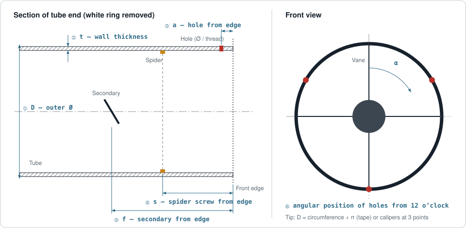

# Measuring the telescope

<sub>**English** · [Deutsch](../de/messen.md)</sub>

Every dimension of the dew shield depends on a few values of your own tube. This guide shows what to measure and how. Allow about 30 minutes.



## You need

- Calipers (digital, 150 mm is enough)
- Flexible tape measure (tailor’s tape)
- Kitchen scale
- Screwdrivers or hex keys for the front-ring screws
- Masking tape and a pen
- Phone for photos

> [!CAUTION]
> First lay the tube **horizontally** with the opening tilted slightly down. Then nothing can fall onto the primary mirror. Do not touch the secondary mirror.

## 1 · Remove the white front ring

1. Before loosening it, mark the ring at **12 o’clock** with masking tape, looking at the tube from the front. All angles below refer to this mark.
2. Remove the screws and keep them.
3. Take the ring off and **weigh** it (value ③ in the sheet below).
4. Take photos: the ring from both sides, the tube’s front edge, one hole close up.

## 2 · Outer diameter D

This is the most important value. The inner lip and the U-profile are derived from it.

- **Tape:** Measure the circumference about 10 mm behind the front edge, then D = circumference ÷ π. Example: 729 mm ÷ 3.1416 = 232.0 mm.
- **Calipers:** Measure with the large jaws at three points, 60° apart, and take the mean. If the values differ by more than 1 mm, the tube is slightly oval; record all three.

## 3 · Wall thickness t

Measure with the caliper jaws right at the front edge. If the edge is **flanged** or rolled, take a profile photo and measure the wall 20 mm further back at a hole.

## 4 · Front-ring holes

Record for each hole:

| | How |
|---|---|
| Angle α | from the 12 o’clock mark, clockwise, seen from the front. The easiest way is the arc length with the tape: α = arc length ÷ circumference × 360° |
| Distance a | from the front edge to the hole centre |
| Ø or thread | hole Ø with calipers. Is there a nut or a thread in the tube? Screw type (self-tapping, M4, M5 …) |

## 5 · Spider and secondary

- **s:** distance from the front edge to the centre of the spider screws on the outside of the tube. The shield’s inner lip must end before them.
- **f:** distance from the front edge to the centre of the secondary mirror. Use the caliper’s depth rod from inside, or a ruler across the opening.
- **Vane angles:** Is a vane at 12 o’clock? The heater cable will run along it.

## 6 · Carrier plate, EL foil and inverter

| Part | Values |
|---|---|
| Carrier plate | Ø, thickness, material, weight |
| EL foil | Ø of the lit area, position and height of the connector |
| Inverter | L × W × H, cable exits, mounting (tabs, holes) |

## 7 · Position on the tube

Where are the finder, the dovetail bar and the focuser, as clock positions seen from the front? The drive block should sit at 12 o’clock without colliding with anything.

## Measurement sheet

The easiest way is to open an issue with the **“Measurements”** template, or copy this:

```text
① D outer Ø (without ring):      ___ mm   (circumference: ___ mm)
② t wall thickness:              ___ mm   edge straight / flanged
③ weight of white ring:          ___ g
④ holes: count ___
   α: ___° ___° ___°   a: ___ mm   Ø/thread: ___   screw: ___
⑤ s spider screw from edge:      ___ mm
⑥ f secondary from edge:         ___ mm   vane at 12 o’clock: yes / no
⑦ carrier plate Ø/thick/weight:  ___ / ___ / ___   lit area Ø: ___
⑧ inverter L×W×H:                ___ × ___ × ___ mm
⑨ finder / dovetail / focuser:   ___ / ___ / ___ (o’clock)
```
